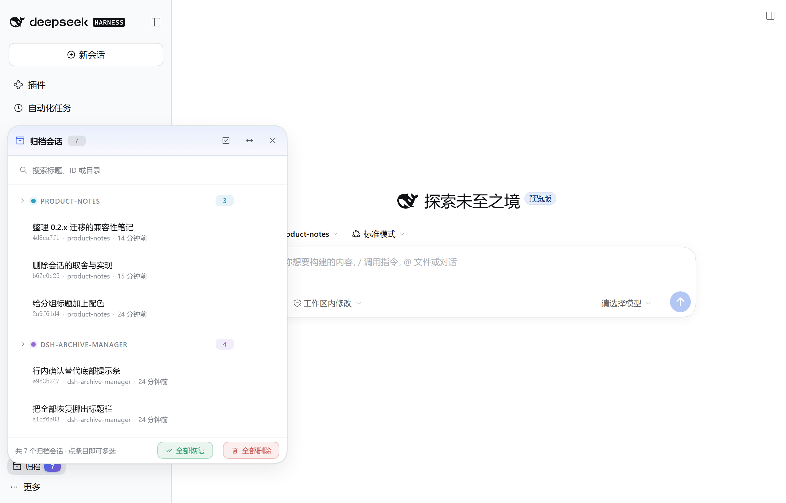
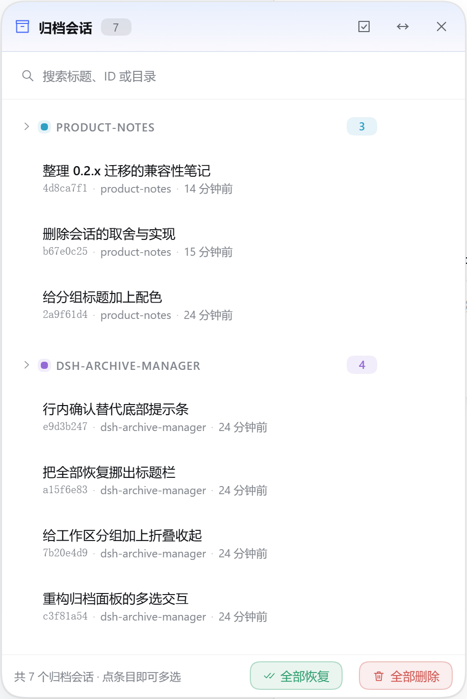
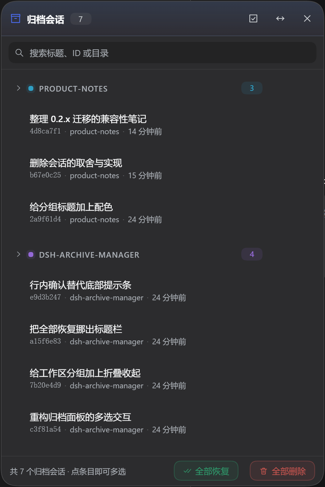
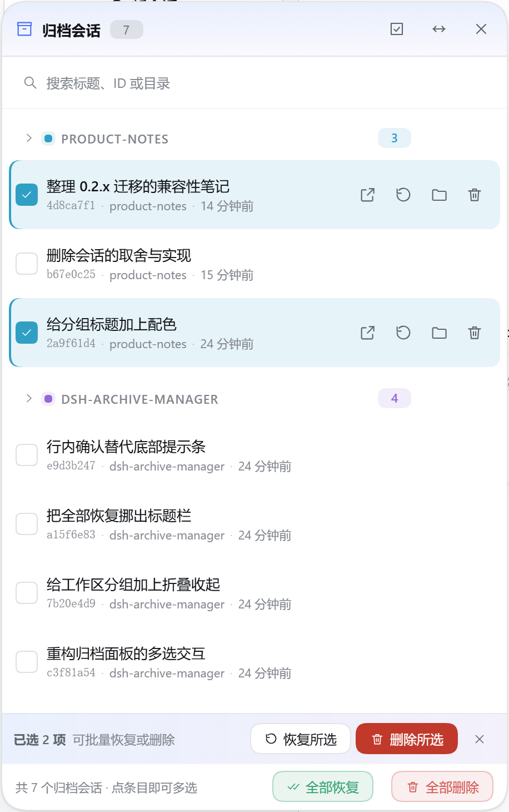
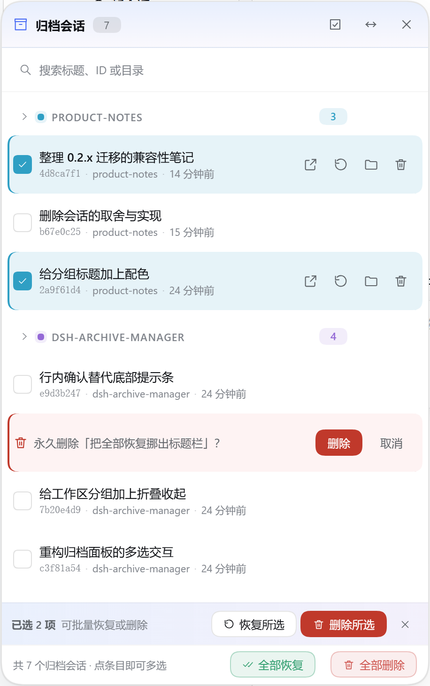
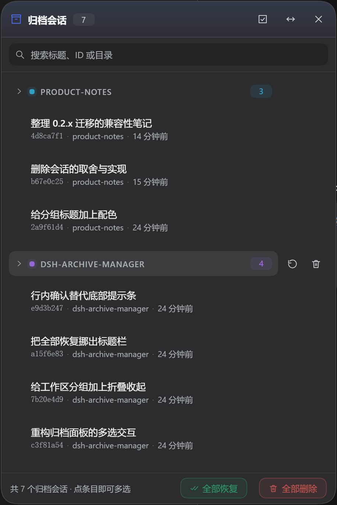
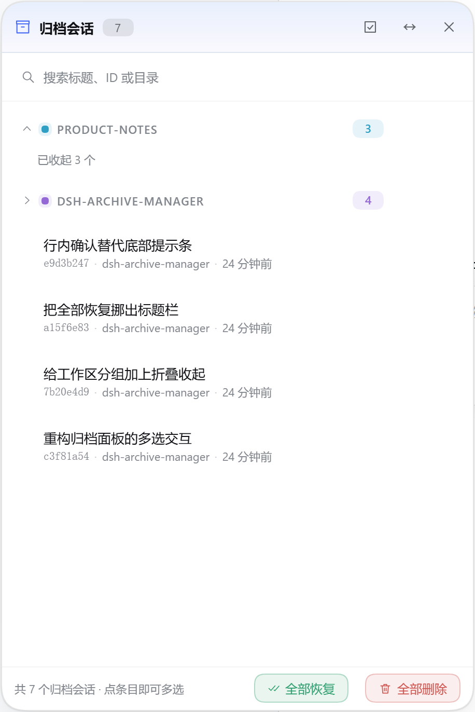

# 归档会话管理器 · dsh-archive-manager

[简体中文](README.md) | [English](README.en.md)

给 [DeepSeek Harness](https://github.com/deepseek-ai/deepseek-harness) 用的归档会话面板：侧边栏底部一个小入口，点开就是一整个归档库——**按工作区分组、能搜索、能多选、能整组收拾、能删干净**。



**一眼看完它能干什么**：按工作区分组、搜索标题 / 会话 ID / 工作目录、多选恢复、多选删除、整组恢复、整组删除、分组折叠收起、行内删除确认、全部恢复、全部删除、按工作区配颜色、入口宽度可选、深浅色自适应、`Esc` 或点击面板外自动收起、面板可拖拽可八向缩放。

---

## 为什么会有这个插件

我平时在 DSH 里同时开着好几个工作区：写文档一个、改插件一个、翻笔记又一个。DSH 自带的「归档会话」很好用，但归档之后它们就散落在侧边栏各个工作区里，想找一条三天前收起来的东西，得先把整个列表翻一遍。

所以我想要一张**归档的收纳桌**：所有收起来的东西都在这张桌子上，按工作区分堆、标上数量，一眼能数清；要用的挑出来放回去，不要的直接扔掉。这就是这个插件。

顺带一句：它最早是为了修「新版 DSH 装不上」才重写的，后来被我一路加了多选、整组操作、折叠和配色——**我自己每天在用，所以哪里点着别扭就改哪里**。

---

## 界面

| 浅色 | 深色 |
| :--: | :--: |
|  |  |

### 多选：整行都是选择区

不用非得去点最左边那个小方框——**点行条任意位置就能勾上**（点右边的操作图标除外，那还是会执行操作）。勾上之后底部浮出批量栏，可以一次恢复或删除。



### 删除：确认就长在这一行上

点垃圾桶，**这一行原地变成确认条**（`永久删除「…」？` + 删除 / 取消），不弹窗、不跳位、不把下面的行挤走。批量删除只在批量栏确认一次，整组删除只在工作组标题里确认一次。



### 整组操作：鼠标移到工作区标题上就会出现

每个工作区分组自带「恢复整组 / 删除整组」，数量写在提示里；点标题本身可以**把整组折叠起来**，只留一行 `已收起 N 个`。折叠只是视觉上的——收起来的行仍然算在「全部恢复 / 全部删除」里，不会偷偷改变批量操作的范围。

| 整组操作 | 折叠收起 |
| :--: | :--: |
|  |  |

### 入口：紧凑小芯片，也可以拉通栏

侧边栏底部默认是一枚紧凑的小芯片（带归档数量角标）：


面板右上角的「拉宽」按钮可以把它切成通栏样式，和上面的会话列表对齐；这个选择按浏览器记住，收起的窄边栏则始终是方图标。

---

## 功能细节

- **归档总览，按工作区分组** — 面板从侧边栏底部 `sidebar.footer.action` 打开，每条归档会话挂在自己的工作区标题下（不属于任何工作区的落到「未分组」），新归档的排在前面，显示标题、短 ID、相对时间和工作目录。
- **恢复** — 走 DSH 自己的 `workspaces.unarchiveSession(id)`，侧边栏、工作区记账和持久化层一起同步，不是改完界面就算数。
- **多选** — 点行条即选中，批量栏提供「恢复所选 / 删除所选 / 清除」，标题栏可以「全选」当前可见项；选择集每次渲染都对着真实归档集过滤，已经消失的行不会被误操作。
- **整组恢复 / 整组删除** — 悬停工作区标题时出现在右侧，数量写在 tooltip 里；删除只在这个标题内部确认，也只影响这一组。
- **折叠收起** — 工作区标题本身就是折叠开关（箭头、色点、标题、数量），折叠后留一行 `已收起 N 个`。
- **全部恢复 / 全部删除** — 都在面板底部，带图标和文字，**故意离右上角的 ✕ 很远**（以前挨着它，太容易误点）。「全部删除」先在底部问一次，再逐条删；两个按钮都尊重当前搜索过滤，并且遇到失败会报告「成功 N 条、失败 M 条」而不是直接中断。
- **搜索** — 按标题、会话 ID 或工作目录过滤。
- **恢复并打开** — 恢复之后直接把会话在主视图里打开（`uiWorkspace` 不可用时会优雅降级）。
- **显示工作目录** — 交给宿主机在系统文件管理器里定位会话的 `cwd`（`session/openWorkspacePath { action: "reveal" }`）。
- **删除** — 插件里唯一的破坏性操作，见下面「删除的代价」。
- **配色** — 每个工作区从 ID 哈希出一个稳定的强调色（删行不会让颜色乱跳），用在标题色点、数量胶囊和分组底色上；入口角标和面板标题是渐变，行操作的悬停色调各自不同（打开=蓝、恢复=绿、定位=琥珀、删除=红），批量栏和空状态是带品牌色的色块。所有颜色都由 `--dsw-alias-*` 变量推导，跟随 DSH 主题明暗切换。
- **自己会收起来** — `Esc` 关闭，点面板外面任意位置也关闭；标题栏可拖拽，八条边/角都能缩放，位置尺寸会被限制在视口内；触摸设备上操作图标常显。
- **尺寸友好** — 工作区标题是 34px 高的整行按钮，四个行操作是 30px 方块配 16px 图标，行高 50px，面板默认 456×552（最小 344×280），不挤字。
- **中英双语** — 优先跟随 DSH 的界面语言，其次看浏览器语言。
- **客户端 UI + 一个宿主远程方法** — 面板是直接发给浏览器的 ESM，没有构建步骤；唯一需要碰磁盘的删除动作交给一个很小的宿主服务，而不是让页面去动文件系统。

---

## 它是怎么工作的

老版本（≤ 0.5.x）在宿主上注册了一个根级 Typert Remote 服务，再在浏览器端用 `ctx.remote.$mount(...)` 挂手写描述符。这套做法在 DSH 0.2 上活不下来：贡献的描述符会被严格校验（`validateContribution` → `requireStrictInputs`，还要避开内置 `remote.*` 的命名冲突），而归档本身已经变成 `workspaces` 客户端服务的一等公民。所以**所有可逆操作**——列清单、搜索、恢复、打开、定位——都直接调用 DSH 已有的服务。

只有删除是 DSH 没提供的。`sessionController` 里没有删除端点，`workspace-files` 是只读的，浏览器也碰不到 `~/.dsh/sessions/...`。于是 0.7.0 起多了唯一一个宿主远程方法：

| 层 | 做什么 |
|---|---|
| 宿主 `src/index.js` | `ArchiveManagerService extends TypertRemoteService`（服务键 / 命名空间 `archiveManager`），只有一个方法 `deleteSession(request)`：先检查是否在跑，再用 `sessionPersistence.stat` + `locate` 定位日志并 unlink，把它从 `archivedSessionIds` 摘掉、从各工作区 detach，最后发出 `api-session/removed`。返回结果值（`{ deleted: true, … }` 或 `{ deleted: false, reason }`），不靠抛异常表达业务失败。 |
| 浏览器 `src/client.js` | 注册 `sidebar.footer.action` 槽位；把 `workspaces.list`（`{ items, archivedSessionIds, pinnedSessionIds, … }`）和 `sessions.list`（`{ ids, byId, … }`）当响应式快照读；恢复走 `workspaces.unarchiveSession(id)`，打开走 `uiWorkspace.openSession(id)`，定位走 `remote.session.openWorkspacePath({ path, action: "reveal" })`，删除走挂载后的 `remote.archiveManager.deleteSession({ sessionId })`。挂载失败时面板照常可用，只是垃圾桶会显示为不可用。 |

没有改 DSH 一行源码：插件由标准加载器发现（profile 的 `cordis.patch.yml` / `dsh.profile.bundles`），浏览器半边由客户端模块加载器加载（`dsh.client.platform = "web"`）。

---

## 兼容性

- **DSH 0.2.1-rc.3 及更新的桌面端**——对着 `@deepseek-ai/dsh-desktop-runtime 0.2.1-rc.3` 实测：宿主服务能注册、`archiveManager/deleteSession` 在真实网关上可用、浏览器 bundle 能被服务端返回、槽位注册成功、面板对着真实的 `workspaces` / `sessions` / `remote.session` 渲染。
- **版本门槛**：manifest 里写的是 `engines.dsh`（`>=0.2.1-0 <1.0.0`），这是 DSH 0.2 唯一会检查的兼容性字段。老版本用的是 `@deepseek-ai/dsh-*` 的 peer 版本区间，而 semver 的预发布规则让 `0.2.1-rc.3` 不满足 `>=0.1.0-rc.6`——这就是当年「装不上」的真正原因。
- **不再支持 DSH 0.1.x**：依赖 `workspaces` 客户端服务（归档快照 + `unarchiveSession`）、`session/openWorkspacePath` 端点，以及 0.2 线的 `TypertRemoteService` / `@Remote` 宿主 API。
- 跨平台：定位文件夹交给宿主，Explorer / Finder / xdg-open 都行。

---

## 安装

### 官方 CLI（推荐，不需要全局安装）

```powershell
npx --yes @deepseek-ai/dsh plugin --profile desktop add https://github.com/Earnest02522/dsh-archive-manager.git
```

桌面端 profile 名叫 `desktop`；`dsh web` 环境用 `--profile web`。

> 桌面端 profile 必须先存在：先打开一次 DeepSeek Harness Desktop，然后**完全退出**再执行命令。

### 或者先全局装 CLI

```powershell
npm install -g @deepseek-ai/dsh
dsh plugin --profile desktop add https://github.com/Earnest02522/dsh-archive-manager.git
```

两种写法等价。包里有 `dsh.bundle` 清单，`plugin add` 会自动写依赖**并**登记加载器条目，不用手改 patch。本地目录也可以：

```powershell
npx --yes @deepseek-ai/dsh plugin --profile desktop add "file:D:\path\to\dsh-archive-manager"
```

> 装完重启 DSH（或让 patch HMR 重新合成配置），浏览器再硬刷新一次（`Ctrl+Shift+R`）。

### 安装脚本（备用方案）

```powershell
cd <repo 路径>
powershell -ExecutionPolicy Bypass -File .\scripts\install.ps1
# 指定 profile：
powershell -ExecutionPolicy Bypass -File .\scripts\install.ps1 -ProfileName desktop
```

脚本会按 `desktop` → `web` → 唯一存在的 profile 自动挑选，把插件复制进 `<profile>/node_modules`，并在 `<profile>/cordis.patch.yml` 里启用它（改之前先建带时间戳的备份；已经存在就什么都不做）。

Linux / macOS：

```bash
cd <repo 路径>
bash scripts/install.sh
# bash scripts/install.sh web "@earnest020522/dsh-archive-manager"
```

脚本优先用 `$DSH_HOME`，没有就用 `~/.dsh`，也能处理空 `[]` 的 patch 模板。

### 手动安装

1. 把这个目录复制到 `%USERPROFILE%\.dsh\profiles\desktop\node_modules\dsh-archive-manager`（或者加进所使用 profile 的 `dsh.profile.bundles`）。
2. 编辑 `%USERPROFILE%\.dsh\profiles\desktop\cordis.patch.yml`，追加：

   ```yaml
   - insert:
       - id: dsh-archive-manager
         name: dsh-archive-manager
   ```

3. 重启 DSH，硬刷新浏览器。

---

## 怎么确认装好了

- 侧边栏底部「设置」旁边出现 **归档 / Archive** 按钮，带数量角标。
- 点开：归档会话按工作区分组列出，带搜索、行操作和底部计数。
- 悬停某一行出现垃圾桶；点它这一行原地变成确认条，确认后提示「已删除」，行自己消失；正在运行的会话会被拒绝。
- 勾几行：底部浮出批量栏，可恢复或删除所选；批量删除只问一次。
- 悬停工作区标题：右侧出现「恢复整组 / 删除整组」，删除只影响这一组，而且在这个标题内部确认。
- 点工作区标题：整组折叠成一行 `已收起 N 个`，再点展开；收起的行仍然参与批量操作。
- 「全部恢复 / 全部删除」在面板底部、带文字标签，离 ✕ 很远；「全部删除」会先在底部问一次。
- 面板按工作区上了颜色（色点、数量胶囊、分组底色），并跟随主题明暗。
- 点面板外面任意位置：面板收起，和按 `Esc` 一样。
- 打开 DSH 开发者工具：预加载列表里能看到 `plugins/??dsh-archive-manager/client.js`，控制台没有模块加载错误。
- 宿主半边是否在线，看 `archiveManager/deleteSession` 有没有响应；宿主半边缺失只会让垃圾桶不可用，其余功能照常。

---

## 卸载

```powershell
npx --yes @deepseek-ai/dsh plugin --profile desktop remove dsh-archive-manager
# 全局安装时等价于：dsh plugin --profile desktop remove dsh-archive-manager
```

然后重启 DSH。备用方案：跑 `powershell -ExecutionPolicy Bypass -File .\scripts\uninstall.ps1`，或者手动从 profile 的 `cordis.patch.yml` 里删掉 `dsh-archive-manager` 那一行、再删 `<profile>/node_modules/dsh-archive-manager`。

---

## 开发与测试

没有构建步骤：`src/index.js` 是宿主插件（一个远程方法），`src/client.js` 是模块加载器格式的浏览器 bundle。

```powershell
node --check src/index.js
node --check src/client.js
node test/client.test.mjs
```

`node test/client.test.mjs` 是一个零依赖的自测套件：自带手写 mini React 运行时，桩掉 `window.__ModuleLoader__` / `document` / `navigator`，把插件挂到假 `ctx` 上，跑 **220 项断言**——加载契约、槽位注册、中文回退、分组（3 个工作区 → 3 组）、搜索过滤、单条恢复、恢复并打开、批量恢复、定位请求载荷、行内删除确认（行不跳位、确认前不删、描述符带网关要求的严格 codec、mount 复用、删除后重新同步归档快照）、多选恢复/删除、全选、点行条选中（点操作按钮不选中但照常执行）、整组恢复/删除、全部恢复/全部删除在底部而不在 ✕ 旁边、分组折叠（行隐藏、回执计数、其他组不受影响、展开恢复）、点击外部收起、入口宽度偏好（默认紧凑、切换后记住、窄边栏保持方形）、目标尺寸（30px 操作块、34px 分组开关、50px 行高）、运行中被拒、缺少 `unarchiveSession` 或缺网关时的降级、空归档与窄侧边栏渲染、拖拽缩放的几何计算、`Esc`，以及针对两边源码的静态断言（浏览器半边只 require `react`、不 `unlink`；宿主半边只 import `node:fs/promises` 和 Typert 协议、只删单个文件、从不用 `recursive: true`）。最后还会检查文档本身：主 README 是中文、有顿号功能行、截图文件都在仓库里且是有效 PNG、中英两版互相链接。

测试只读插件自己的源码，不会碰任何 DSH 安装。

---

## 删除的代价

删除**不是**归档操作——归档只是把会话 ID 藏起来，删除是真的删文件，而且不可撤销：

1. **正在跑就拒绝。** 宿主先问 `workspace/session-activity` 瀑布，有活动就返回 `{ deleted: false, reason: "session-active" }`，面板会提示你先停下。
2. **删掉会话日志文件。** 通过 `sessionPersistence.stat(id)` + `locate(...)` 定位（压缩过的 `.jsonl.zstd` 也认），只 unlink 这一个文件；文件本来就不在了也算成功（`existed: false`）。
3. **清理记账。** 从 `archivedSessionIds` 摘掉、从所有列着它的工作区 detach，并发出 `api-session/removed`，让已经打开的窗口不用重启就能把这一行去掉。DSH 自己的查询索引会在下一次扫描时对账。
4. **没有后悔药。** 没有回收站、没有撤销，内置的「恢复」也恢复不了。只是想让会话别挡路，请用「归档」。

批量删除就是把单条调用按顺序跑一遍：某一条还在运行就单条失败，最终报告「成功 N 条、失败 M 条」，其余照常；任何一次请求都只删一个解析出来的文件路径，绝不会递归删目录——所以套件里也专门断言了宿主半边没有 `rmSync`、没有 `recursive: true`。

持久化那层故意不提供删除接口，这是插件唯一越过 DSH 公开 API 的地方，所以才有显式确认和「运行中拒绝」这两道闸。

---

## 已知限制

- **删除是永久的**——没有回收站、不能撤销。行为有行内确认和运行中保护，但一旦成功，日志就没了。
- **「显示工作目录」定位的是 `cwd`**，不是日志目录：DSH 0.2 不再把会话日志路径暴露给客户端插件，所以老版本的「打开会话文件夹」被改成了定位工作目录。
- **投影缓存会留下。** 删除只 unlink 会话日志，`storages/session_projcache/` 下的小缓存是 DSH 自己的，下一次扫描会自行对账，插件不去动它。
- 恢复和删除后面板是乐观刷新；权威的 `archivedSessionIds` 会在下一次工作区基线（重连 / 刷新列表）时对齐。
- 会话的 agent 还在运行时，恢复和删除都会被宿主拒绝，面板用错误提示告诉你。

---

## 关于我

我是 Earnest，日常在 DeepSeek Harness 里写文档、改插件、记零碎想法，归档一多就受不了那种「东西还在、但找不到」的感觉。这个插件的每个细节基本都是我用着别扭之后改出来的：确认条从底部搬到了行内、全部恢复从 ✕ 旁边挪到了底部、勾选从只认小方框变成了整行可点。

如果你也在用，或者发现哪里还别扭，欢迎开 issue：<https://github.com/Earnest02522/dsh-archive-manager/issues>。

> **关于截图里的数据**：文中所有截图都来自一次性测试 profile，里面两个工作区（`dsh-archive-manager`、`product-notes`）和 7 条会话标题全是手写的示例内容，没有任何真实会话标题、真实路径或账号信息；截图完成后测试 profile 即被丢弃。

---

## 许可证

MIT
